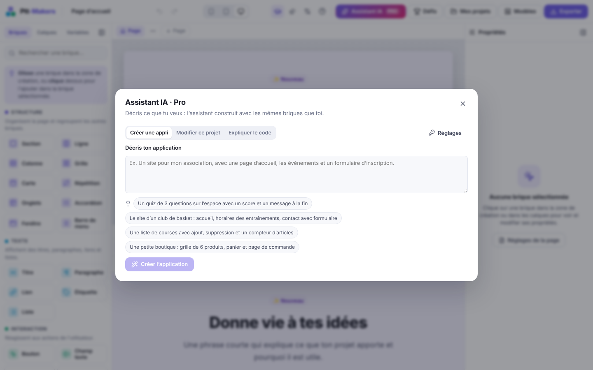
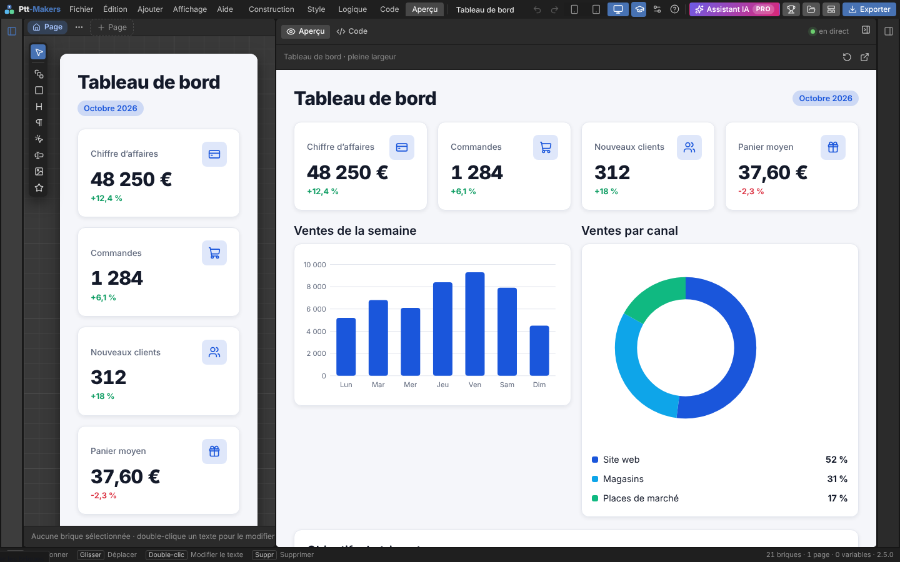
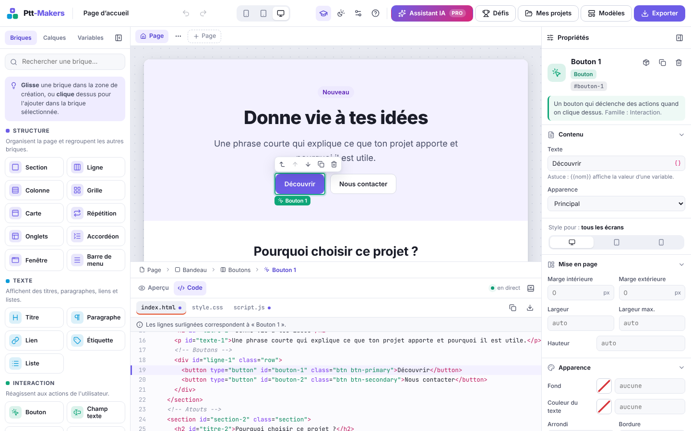
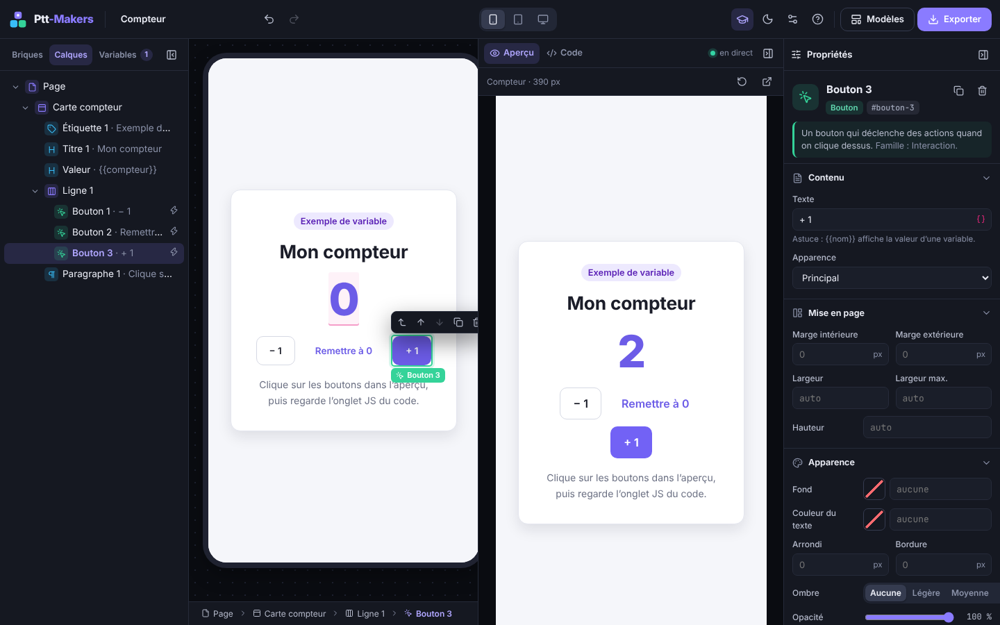
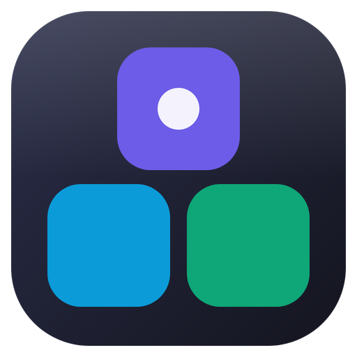

# Ptt-Makers

**L'atelier visuel de création logicielle.** Assemble des briques, règle-les, teste ton application en direct… et regarde le vrai code s'écrire en même temps.

 **Essayer en ligne : [emmanuel-creat.github.io/Ptt-Makers](https://emmanuel-creat.github.io/Ptt-Makers/)** (fonctionne aussi sur téléphone).


## Pourquoi ?

Créer une application demande de maîtriser plusieurs langages et des notions abstraites. Les outils « no-code » simplifient, mais cachent le code : on produit sans comprendre. Ptt-Makers fait les deux : on **construit visuellement** et on **apprend comment ça marche**, parce que chaque brique est reliée à ses lignes de HTML, CSS et JavaScript.

## Ce que tu peux faire

-  **Interface de logiciel pro**, façon Blender : barre de menus, espaces de travail (Construction, Style, Logique, Code, Aperçu), barre d'outils verticale, propriétés à onglets d'icônes, barre d'état et écran d'accueil. L'interface classique claire reste à un clic.
-  **37 briques** en 5 familles colorées (structure, texte, interaction, médias, pro), dont des onglets, un accordéon, une fenêtre, une barre de menu, une vidéo et un formulaire complet, à glisser ou à ajouter d'un clic.
-  **Briques pro** pour de vrais logiciels : tableau triable, graphiques (barres, courbe, anneau), chiffres clés, barre de progression, calendrier, kanban à faire glisser, discussion et barre d'onglets mobile.
-  **Galerie de 30 modèles** classés en familles, avec une recherche : CRM, facturation avec TVA, réservations, ressources humaines, gestion de stock, dépenses, bibliothèque, notes des élèves, support client, recrutement, flotte de véhicules, salle de sport, recettes, inventaire, suivi des heures, inscriptions, dons, espace membres…
-  **Écrans de logiciel** : un cadre d'application avec barre latérale et liens de pages, un en-tête avec titre et boutons, et des **grilles à zones nommées** (`stats stats graphique`) pour composer un tableau de bord. Le modèle Back-office les réunit.
-  **Formulaires complets** : champs vérifiés avant l'envoi (dates, heures, e-mail, téléphone, adresse web, minimum et maximum), actions à l'envoi, message de succès et remise à zéro.
-  **Tableau avancé** : cases modifiables sur place, lignes à cocher pour une suppression groupée, colonnes redimensionnables et tri.
-  **États et variantes** : un style au survol, au focus, à l'appui ou désactivé pour chaque brique, et des **variantes de composants** (« Mise en avant », « Danger ») choisies copie par copie.
-  **Mode sombre** dans l'application générée : une ambiance sombre calculée à partir du style, qui suit l'appareil ou se change avec un bouton.
-  **Gabarits de pages** (tableau de bord, paramètres, connexion, liste et détail) et **alignement d'une sélection** (aligner, centrer, répartir sur la grille).
-  **Données (collections)** : une petite base de données dans le projet, avec des champs typés (texte, nombre, date, oui/non, image, lien). Un clic crée le formulaire qui ajoute des fiches et le tableau qui se met à jour tout seul, avec un bouton Supprimer par ligne. Import d'un fichier CSV, et données gardées dans le navigateur de l'application, même après un rechargement. Une barre de recherche, un filtre (« la catégorie est égale à {{choix}} ») et un tri s'appliquent à un tableau ou à une répétition sans toucher aux données.
-  **Formules** comme dans un tableur : des champs calculés (`quantite * prix`) et des calculs dans les textes : `{{somme(produits.valeur)}} €`, `{{moyenne(notes)}}`, `{{arrondi(total / 3, 2)}}`, `{{"Bonjour " & prenom}}`.
-  **Zone de création** fidèle au résultat : sélection, glisser-déposer avec indicateur, barre d'actions flottante, édition du texte sur place, formats mobile / tablette / ordinateur.
-  **Propriétés** claires : contenu, mise en page, apparence, typographie, interactions.
-  **Interactions sans code** : variables, textes dynamiques `{{nom}}`, champs reliés, affichage conditionnel, actions au clic.
-  **Plusieurs pages** avec navigation, dans un seul fichier exporté.
-  **Listes dynamiques** : une brique Répétition affiche une copie par élément (tâches, fiches, produits…).
-  **Événements** : clic, survol, saisie, changement de valeur, touche (Entrée, Échap, flèches) et **minuterie** de page pour une horloge ou des données rafraîchies.
-  **Fonctions réutilisables** : une suite d'actions écrite une fois et lancée de partout ; renommer une fonction met tous ses appels à jour.
-  **Débogueur pas à pas** dans l'aperçu : chaque action lancée, d'où elle vient, et les variables en direct ; en pas à pas, l'application attend *Action suivante*.
-  **Logique** : actions « Si… alors… sinon… » avec des conditions **et/ou** et la comparaison de deux variables, **vérification des formulaires** (obligatoire, longueur, e-mail, nombre minimum et maximum, message sous le champ), **pages qui reçoivent une valeur** (ouvrir la fiche d'un produit), **pauses** et **appels d'API complets** (GET, POST, PUT, PATCH, DELETE, en-têtes, corps JSON) : chaque action attend que la précédente soit finie.
-  **Comptes dans l'application** : créer un compte, se connecter, se déconnecter, et des pages réservées aux personnes connectées. Le mot de passe est gardé chiffré, dans le navigateur de chaque personne.
-  **Brique Code personnalisé** : ton propre HTML, CSS et JavaScript quand aucune brique ne fait ce que tu veux. Dans l'éditeur, il tourne dans un cadre isolé.
-  **Studio de style** : 24 styles prêts à l'emploi (néomorphisme, verre givré, néobrutalisme, bento, terminal…) qui habillent tout le projet d'un clic, et chaque réglage modifiable (couleurs, relief, flou, arrondis, polices).
-  **Mes composants liés** : enregistre un bloc pour le réutiliser partout ; ses copies restent identiques (change l'une, les autres suivent), et une copie se détache d'un clic.
-  **Multi-sélection et groupes** : `Maj + clic` sélectionne plusieurs briques, qu'on groupe (`Ctrl + G`), duplique ou supprime d'un coup ; `Ctrl + Maj + G` dégroupe.
-  **Panneau Problèmes** : la liste des erreurs du projet (variable qui n'existe plus, page disparue, formule mal écrite, adresse d'API invalide…) et des conseils (image sans description, variable inutilisée). Un clic mène à la brique concernée ; la barre d'état affiche le compte.
-  **Versions nommées** : une photo du projet avant un gros changement (« avant la refonte »), à retrouver plus tard d'un clic, sans rien perdre.
-  **Réglages par format** : un style différent, ou une brique masquée, sur tablette ou sur mobile.
-  **Mes projets** : plusieurs projets enregistrés dans le navigateur, et un **lien de partage** qui contient tout le projet.
-  **Défis guidés** : des objectifs en quelques étapes qui se cochent toutes seules.
-  **Placement libre sur une grille** : passe une page « Sur une grille » et pose chaque brique où tu veux (un bouton de menu en haut à gauche, une image à droite…), elle s'aimante sur la case la plus proche.
-  **Version Pro, assistant IA** : décris une application, il la construit avec les briques ; il modifie ton projet sur demande et explique le code. Avec ta clé Anthropic ou un [serveur relais](serveur-ia/README.md).
-  **Aperçu interactif** en temps réel, isolé dans une iframe.
-  **Code en direct** (HTML / CSS / JS) commenté en français, coloré, avec **surlignage de la brique sélectionnée**.
-  **Espace de travail personnalisable** : panneaux redimensionnables et repliables, aperçu à droite ou en bas, thème clair / sombre / système.
-  **Mode débutant** : visite guidée, explications et astuces partout.
-  Annuler / rétablir, raccourcis clavier, sauvegarde automatique, export HTML, **application installable (PWA)** qui marche sans internet et se prépare pour Android et iOS avec Capacitor, **composant React ou Vue**, ou projet `.json`.












## Installer sur ton ordinateur



Télécharge [Ptt-Makers-local.zip](https://emmanuel-creat.github.io/Ptt-Makers/Ptt-Makers-local.zip) (ou menu Fichier, « Installer sur mon ordinateur »), décompresse-le et lance l'installateur de ton système :

- **Windows** : double-clic sur `Installer-Windows.bat` ;
- **macOS** : clic droit sur `Installer-macOS.command`, puis « Ouvrir » ;
- **Linux** : `installer-linux.sh`.

Un raccourci Ptt-Makers avec son icône apparaît sur le bureau. L'atelier marche alors sans internet (sauf l'assistant IA), et tes projets restent sur ton ordinateur.

## Démarrer

Prérequis : [Node.js](https://nodejs.org) 22 ou plus.

```bash
npm install
npm run dev        # http://localhost:5173
```

| Commande | Rôle |
|---|---|
| `npm run dev` | Serveur de développement |
| `npm run build` | Vérification TypeScript + build de production dans `dist/` |
| `npm run preview` | Sert le build de production |
| `npm test` | Tests unitaires (Vitest) |
| `npm run test:e2e` | Tests de bout en bout (Playwright, Chromium) |
| `npm run lint` | Analyse statique (oxlint) |

Le dossier `dist/` est un site statique : il peut être hébergé tel quel (GitHub Pages, Netlify…).

## Documentation

- [Cahier des charges](docs/CAHIER_DES_CHARGES.md) : problématique, solution, fonctionnalités, critères d'acceptation.
- [Dossier de conception](docs/CONCEPTION.md) : architecture, modèle de données, identité visuelle, sécurité, tests.
- [Guide d'utilisation](docs/GUIDE.md) : prise en main et raccourcis.
- [Journal des évolutions](CHANGELOG.md).

## Pile technique

React 19 · TypeScript · Vite · Zustand · lucide-react · Vitest · Playwright. Aucune dépendance serveur.
