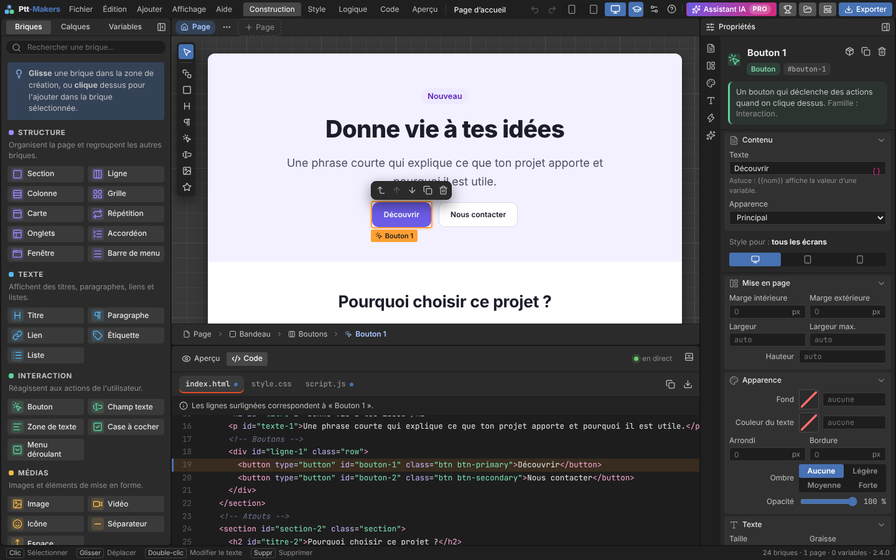
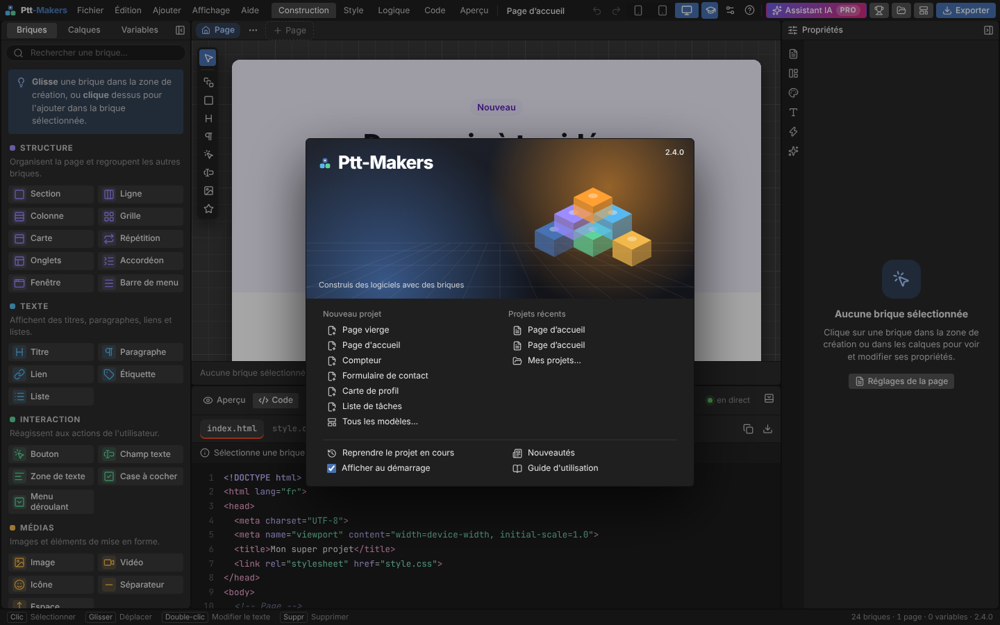
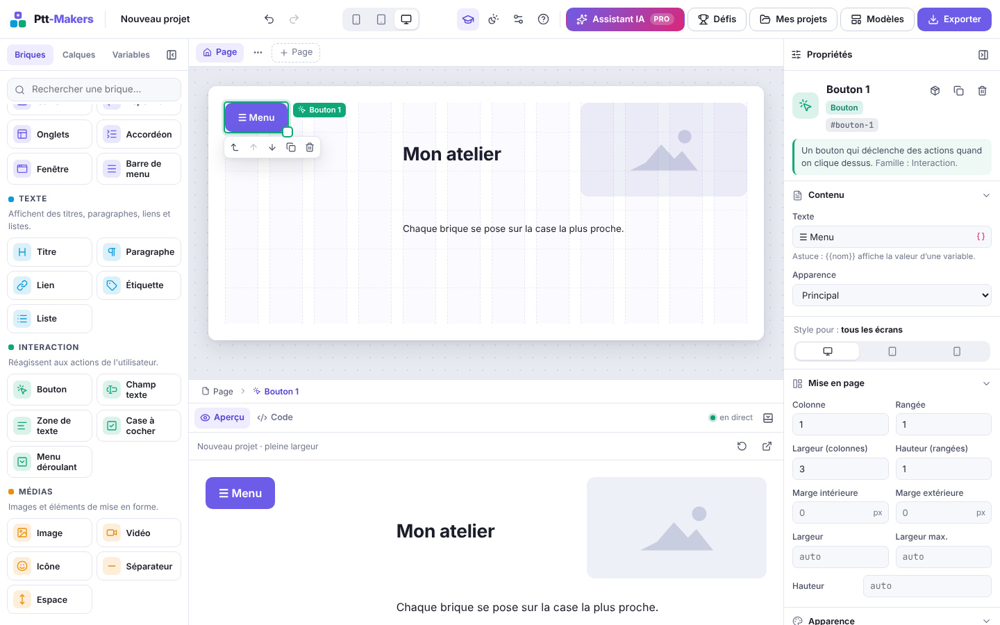
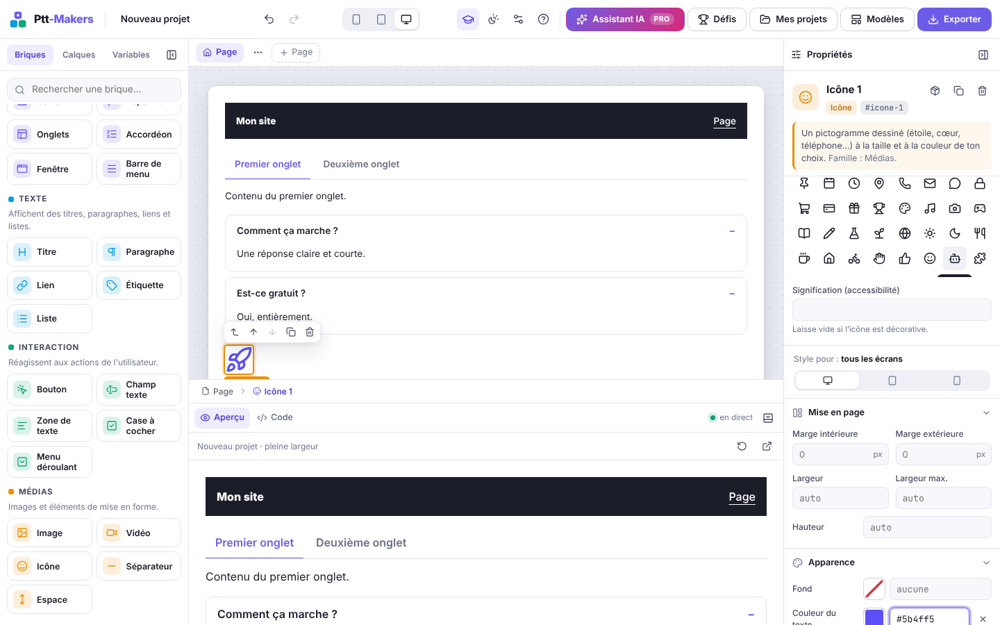
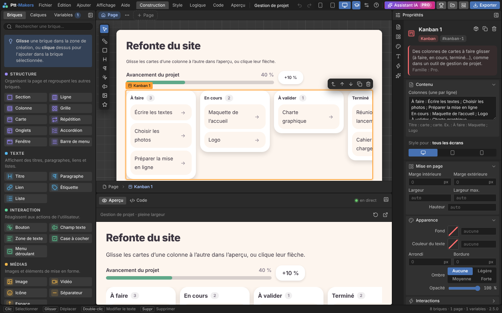
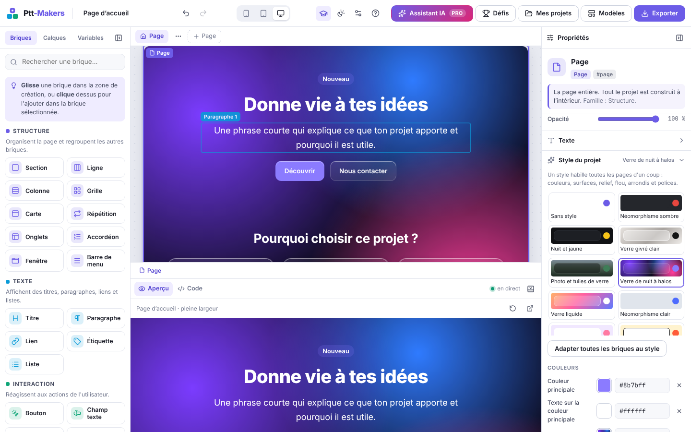
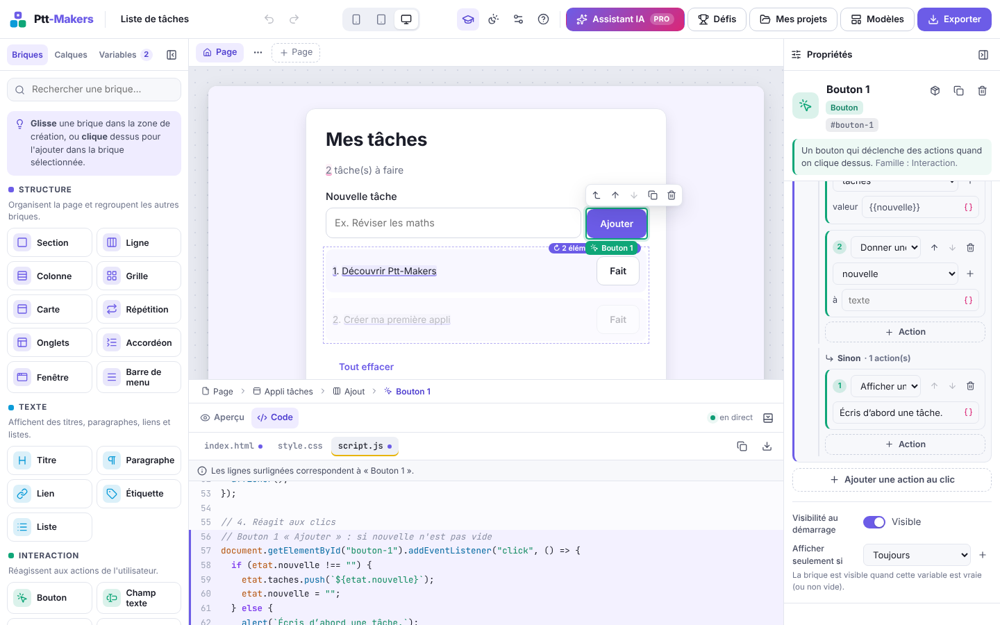
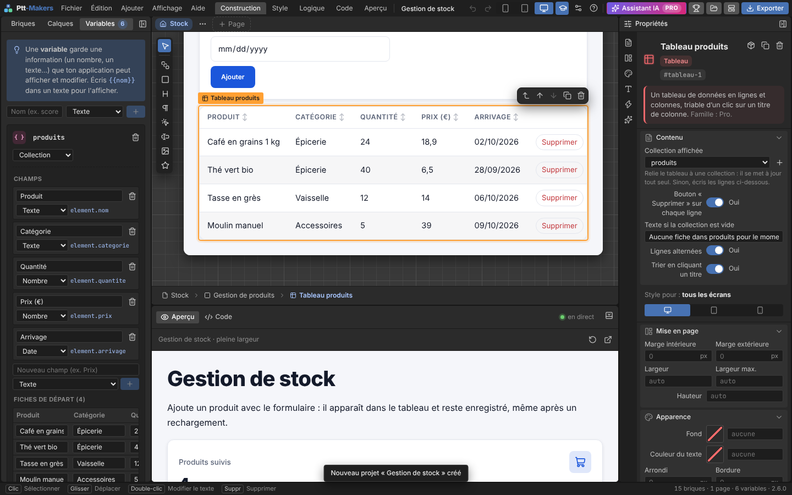

# Guide d'utilisation de Ptt-Makers

## Premiers pas

1. Ouvre Ptt-Makers : une **visite guidée** présente les quatre zones (tu peux la revoir depuis le menu *Aide*). Aux ouvertures suivantes, l'**écran d'accueil** propose un nouveau projet, tes projets récents ou la reprise du projet en cours.
2. Choisis un **modèle** (menu *Fichier* ou bouton *Modèles* en haut à droite) ou pars d'une **page vierge**.
3. Ajoute des briques, règle-les, teste dans l'**aperçu**, lis le **code**.
4. **Exporte** ta page quand elle te plaît.

## Les quatre zones

| Zone | Où | À quoi elle sert |
|---|---|---|
| Outils | à gauche | **Briques** (la bibliothèque), **Calques** (la structure du projet), **Variables** (les données de l'application). |
| Création | au centre | Ta page, telle qu'elle sera. Clique pour sélectionner, glisse pour déplacer, double-clique un texte pour l'écrire directement. |
| Propriétés | à droite | Tout ce qu'on peut régler sur la brique sélectionnée. |
| Aperçu / Code | en bas (ou à droite) | L'application qui fonctionne vraiment, et son code HTML, CSS et JavaScript. |

Les bords entre zones se **redimensionnent** (glisser, ou flèches du clavier ; double-clic pour revenir à la taille par défaut). Le bouton Disposition  de la barre du haut permet de **masquer** une zone ou de placer l'aperçu **à droite** ou **en bas**.

## L'interface pro

Par défaut, Ptt-Makers a l'allure d'un logiciel professionnel, inspirée de Blender : sombre, compacte, avec tout à portée de main.

- **Barre de menus** (en haut à gauche) : *Fichier* (nouveau projet, Mes projets, écran d'accueil, export), *Édition* (annuler, dupliquer, copier, coller, supprimer), *Ajouter* (les briques courantes et une nouvelle page), *Affichage* (format, panneaux, disposition, mode débutant, interface classique) et *Aide*. Survole un autre menu pour passer de l'un à l'autre ; `Échap` referme.
- **Espaces de travail** (les onglets à côté des menus) : chacun range les panneaux pour une tâche.

| Espace | Ce qu'il montre |
|---|---|
| Construction | Briques à gauche, propriétés à droite, aperçu en bas. |
| Style | Calques à gauche, propriétés, aperçu à droite pour juger du rendu. |
| Logique | Variables à gauche, aperçu en bas pour tester les actions. |
| Code | Calques à gauche et code en grand à droite. |
| Aperçu | L'application en grand, sans les panneaux. |

- **Barre d'outils verticale** (sur le bord gauche de la zone de création) : la flèche sélectionne la page, les autres outils ajoutent une section, une carte, un titre, un paragraphe, un bouton, un champ, une image ou une icône à côté de la brique sélectionnée.
- **Onglets d'icônes des propriétés** (colonne étroite à gauche des propriétés) : Contenu, Mise en page, Apparence, Texte, Interactions et Style du projet. Un clic ouvre la section et la fait défiler.
- **Barre d'état** (tout en bas) : les gestes utiles, le nombre de briques, de pages et de variables, et la version.
- **Écran d'accueil** : il s'ouvre au démarrage, et à tout moment depuis *Fichier > Écran d'accueil*. Décoche « Afficher au démarrage » pour ne plus le voir.

Tu préfères l'ancienne allure ? Bouton Disposition  puis **Interface : Classique** (ou *Affichage > Interface classique*). L'interface classique garde ses thèmes clair, sombre et système ; le même réglage ramène l'interface pro.

## Les briques

| Famille | Briques |
|---|---|
|  Structure | Section, Ligne (côte à côte), Colonne (empilé), Grille, Carte, Répétition, Onglets, Accordéon, Fenêtre, Barre de menu |
|  Texte | Titre, Paragraphe, Lien, Étiquette, Liste |
|  Interaction | Bouton, Champ texte, Zone de texte, Case à cocher, Menu déroulant |
|  Médias | Image, Vidéo, Icône, Séparateur, Espace |
|  Pro | Tableau, Graphique, Chiffre clé, Progression, Calendrier, Kanban, Discussion, Barre d'onglets |

- **Ajouter** : glisse une brique vers la zone de création (une ligne violette montre où elle ira), ou **clique** dessus pour l'ajouter dans la brique sélectionnée.
- **Déplacer** : glisse-la dans la zone de création ou dans les **calques** ; ou utilise les flèches de la barre flottante.
- **Renommer** : double-clic dans les calques, ou dans l'en-tête du panneau Propriétés.

### Placer une brique où on veut (page en grille)

Par défaut, les briques d'une page s'empilent les unes sous les autres. Pour les poser librement :

1. Sélectionne la page (bouton « Réglages de la page », ou clic dans un coin vide).
2. Dans **Mise en page**, choisis la disposition **Sur une grille** (icône quadrillée).
3. La page affiche 12 colonnes et des rangées de 40 px. Glisse une brique à l'endroit voulu : un cadre montre la case où elle va se poser (« Colonne 1, rangée 1 » pour le coin en haut à gauche), et elle s'aimante dessus.

- **Déplacer** : glisse la brique ailleurs sur la grille, elle garde sa taille. `Alt + ↑ / ↓` la monte ou la descend d'une rangée, `Alt + ← / →` la décale d'une colonne.
- **Changer la taille** : tire la petite poignée carrée en bas à droite de la brique sélectionnée, ou règle « Largeur (colonnes) » et « Hauteur (rangées) » dans les propriétés.
- **Mettre une brique dans une autre** : au-dessus d'une carte ou d'une section posée sur la grille, dépose au centre pour entrer dedans ; près des bords, la brique se pose sur la grille.
- **Sur mobile**, la grille serait trop étroite : les briques s'empilent dans l'ordre de lecture (de haut en bas, puis de gauche à droite).
- Pour revenir en arrière, choisis **En pile** : les briques s'empilent à nouveau.

### Les briques avancées

- **Onglets** : chaque bloc à l'intérieur est un panneau, et son nom (dans les calques) devient le titre de l'onglet. Dans la zone de création, clique un titre pour modifier son panneau.
- **Accordéon** : même principe, chaque bloc est une question qui s'ouvre au clic. Le réglage « Premier ouvert » ouvre la première au départ.
- **Fenêtre** : elle est cachée au départ. Ajoute à un bouton l'action « Afficher une brique » pour l'ouvrir ; la croix ou un clic à côté la referme.
- **Barre de menu** : elle affiche un lien vers chaque page du projet et met en avant la page affichée.
- **Vidéo** : colle l'adresse d'une vidéo YouTube ou d'un fichier `.mp4` / `.webm`.
- **Icône** : choisis une des 52 icônes dessinées (étoile, cœur, téléphone, e-mail, maison…) dans la grille, ou cherche-la par son nom. Elle prend la taille du texte (« Taille du texte ») et sa couleur (« Couleur du texte »).

### Les briques pro

Leurs données s'écrivent directement dans les propriétés, une ligne par élément.

| Brique | Ce qu'on écrit | Exemple |
|---|---|---|
| Tableau | Les titres dans « Colonnes », puis une ligne par ligne du tableau ; les cellules sont séparées par des points-virgules. | `Camille ; Design ; Lyon` |
| Graphique | Une ligne par donnée : étiquette, deux-points, valeur. Choisis barres, courbe ou anneau, et une unité. | `Lundi : 12` |
| Chiffre clé | Un libellé, une valeur (qui peut contenir une variable) et une évolution : `+` l'affiche en vert, `-` en rouge. | `{{total}} €` · `+8 %` |
| Progression | Une valeur de 0 à 100, ou une variable. | `{{avancement}}` |
| Calendrier | Le mois (`AAAA-MM`, vide pour le mois en cours), puis un événement par ligne. | `12 : Réunion d'équipe` |
| Kanban | Une colonne par ligne : son titre, deux-points, puis ses cartes séparées par des points-virgules. | `À faire : Maquette ; Logo` |
| Discussion | Un message par ligne : auteur, deux-points, message. Les messages de « Ton nom » s'affichent à droite. | `Alex : Salut !` |
| Barre d'onglets | Une icône par page, dans l'ordre (maison, recherche, message, personne, reglages…). Les noms viennent des pages. | `maison` |

Dans l'aperçu et l'application exportée : un clic sur un titre de colonne trie le tableau (un deuxième clic inverse l'ordre), les cartes du kanban se glissent d'une colonne à l'autre (ou passent à la suivante avec leur flèche), un message écrit dans la discussion s'ajoute en bas, et la barre d'onglets reste collée en bas de l'écran. Les modèles **Tableau de bord**, **Gestion de projet** et **Messagerie mobile** montrent ces briques en situation.

### Mes composants

Sélectionne un bloc (une carte, un menu…) et clique sur l'icône Paquet  en haut des propriétés : il rejoint la famille **Mes composants** de la bibliothèque. Glisse-le ou clique dessus pour en placer une copie.

Les copies sont **liées** : change un texte, une couleur ou ajoute une brique dans l'une d'elles, et toutes les autres suivent (le composant aussi). Le nom du bloc, sa place sur une grille, « masquée au départ » et « afficher seulement si » restent propres à chaque copie. Dans les propriétés, un bandeau rappelle qu'il s'agit d'une copie liée ; **Détacher cette copie** en fait un bloc ordinaire, que tu modifies seul. Le × de la tuile retire le composant de la bibliothèque : ses copies restent sur la page, détachées.

### Sélectionner plusieurs briques, grouper

`Maj + clic` (ou `Ctrl + clic`) sur une brique, dans la zone de création ou dans les calques, l'ajoute à la sélection (ou l'en retire). Les autres briques sélectionnées sont encadrées en pointillés, et les propriétés proposent **Grouper**, **Dupliquer** et **Supprimer** pour toutes à la fois. `Échap` revient à une seule brique.

**Grouper** (`Ctrl + G`) range les briques dans un nouveau bloc « Groupe », à la place de la première, dans l'ordre de la page. Elles doivent avoir le même parent. **Dégrouper** (`Ctrl + Maj + G`, ou l'icône en haut des propriétés d'un bloc) sort le contenu du bloc et retire le bloc.

## Style et formats

- **Style du projet** : sélectionne la page, puis ouvre « Style du projet » dans les propriétés. Clique sur un des 24 styles : toutes les pages changent d'un coup (fond, cartes, boutons, champs, barre de menu, polices). Ensuite, chaque réglage se change à la main :
  - **Couleurs** : couleur principale, texte posé dessus, fond des pages (une couleur ou un dégradé comme `linear-gradient(160deg, #ff6a3d, #7a2cff)`), surfaces, texte, texte secondaire, barre de menu, bordures, ambiance claire ou sombre.
  - **Formes** : épaisseur des bordures, arrondi des cartes, arrondi des boutons et champs (999 pour des pilules).
  - **Relief et verre** : plat, doux, porté, néomorphisme, décalé ou verre, avec trois intensités, et le flou derrière les surfaces pour l'effet verre.
  - **Polices** : une pour le texte, une pour les titres.
  - « Revenir aux réglages du style » efface tes changements ; « Sans style » revient au thème simple.

- **Adapter toutes les briques au style** : une couleur, une bordure, une ombre ou un arrondi donné à la main à une brique passe avant le style. Ce bouton les retire pour que tout le projet suive le style (Ctrl+Z pour annuler).
- **Style pour un format** : en haut des propriétés, « Style pour » choisit tous les écrans, la tablette (moins de 900 px) ou le mobile (moins de 600 px). Les réglages faits sur tablette ou mobile ne changent que ce format ; le chiffre à côté de l'icône compte ces réglages. « Masquer sur ce format » cache la brique sur ce format seulement (elle reste visible en transparence dans la zone de création).

## Rendre la page interactive

### Les variables
Une variable garde une information : un **texte**, un **nombre** ou **vrai/faux**. Crée-les dans l'onglet *Variables*.

- Pour **afficher** une variable dans un texte, écris `{{nom}}` (ou utilise le bouton `{ }` à droite du champ).
- Pour la **remplir** avec un champ de saisie, choisis-la dans *Enregistrer dans la variable*.
- Pour **montrer une brique seulement si** une variable est vraie, utilise *Afficher seulement si* (section Interactions).

### Les actions « au clic »
Dans la section **Interactions** d'une brique, ajoute des actions qui s'exécutent quand on clique dessus dans l'aperçu :
donner une valeur à une variable, ajouter un nombre, inverser vrai/faux, afficher/masquer une brique, défiler jusqu'à une brique, afficher un message, ouvrir un lien.

> Exemple : un bouton « + 1 » avec l'action *Ajouter 1 à compteur*, et un titre `{{compteur}}`. C'est le modèle **Compteur**.

Les actions sont rangées par familles : variables, listes, logique, pages et briques, autres (message, lien, données d'API).

### Les conditions
L'action **Si… alors… sinon…** teste une variable (vraie, fausse, égale à, plus grande que, vide…) et lance les actions de la branche *Alors* ou *Sinon*. Une condition peut en contenir d'autres.

> Exemple : *Si nouvelle n'est pas vide, alors ajouter `{{nouvelle}}` à taches et vider nouvelle, sinon afficher « Écris d'abord une tâche ».* C'est le bouton « Ajouter » du modèle **Liste de tâches**.

### Vérifier un formulaire
Chaque champ (texte, zone de texte, menu, case à cocher) a des **règles** dans ses propriétés : **Obligatoire**, **Nombre minimal de caractères**, **Nombre minimum** et **maximum** (pour un champ de type Nombre) et un **Message d'erreur** à toi. Un champ de type E-mail vérifie toujours l'adresse. Un champ obligatoire porte une petite étoile.

Mets l'action **Vérifier un formulaire** en premier sur le bouton d'envoi et choisis la brique qui contient les champs (la carte du formulaire, le plus souvent). Au clic, chaque erreur s'affiche sous son champ, le curseur va sur la première, et **les actions suivantes ne sont pas faites** tant qu'une règle n'est pas respectée. L'erreur disparaît dès que le champ est corrigé. Le modèle **Formulaire de contact** le montre.

### Attendre
L'action **Attendre** fait une pause (en millisecondes : 1000 pour une seconde) avant l'action suivante. La page montre ce qui a déjà changé avant la pause : pratique pour un message « Enregistrement… » qui laisse place à « C'est fait ! ».

## Les listes

1. Dans *Variables*, crée une variable de type **Liste**. Ses éléments de départ s'écrivent un par ligne.
2. Ajoute une brique **Répétition** (famille Structure) et choisis la liste à parcourir.
3. Place des briques dedans : elles seront **copiées pour chaque élément**. Écris `{{element}}` pour afficher l'élément, `{{position}}` pour son numéro.
4. Un bouton placé dans la répétition peut **retirer l'élément de sa copie**.

`{{taches}}` écrit ailleurs affiche le **nombre** d'éléments de la liste. Dans la zone de création, la première copie est modifiable et les suivantes apparaissent en transparence.

## Les données (collections)

Une **collection** est une petite base de données : une liste de **fiches** qui ont toutes les mêmes **champs** (comme les colonnes d'un tableur).

1. Dans *Variables*, crée une variable de type **Collection**.
2. Ajoute ses **champs** : un nom affiché et un type (Texte, Nombre, Date, Oui / non, Image, Lien). Le nom technique affiché à côté (`element.prix`) sert dans une répétition ; il ne change pas si tu renommes le champ.
3. Ajoute des **fiches de départ** à la main, ou **importe un fichier CSV** (séparé par des points-virgules ou des virgules, la première ligne donne les titres) : les types des champs sont devinés.
4. Clique **Créer un formulaire et un tableau** : Ptt-Makers ajoute à la page un champ de saisie par champ (chacun relié à une nouvelle variable), un bouton **Ajouter** et un **tableau relié** à la collection.

Dans l'aperçu et l'application exportée, le bouton ajoute la fiche puis vide le formulaire, le tableau se met à jour tout seul, et le bouton **Supprimer** d'une ligne retire sa fiche. `{{produits}}` écrit dans un texte ou un chiffre clé affiche le **nombre** de fiches.

À la main :

- un **Tableau** se relie à une collection avec sa propriété **Collection affichée** (et, si tu veux, le bouton « Supprimer » sur chaque ligne et un texte quand elle est vide) ;
- l'action **Ajouter une fiche à une collection** propose une valeur par champ : écris un texte ou une variable reliée à un champ de saisie (`{{nom_saisi}}`) ;
- une **Répétition** peut parcourir une collection : « Insérer une variable » propose alors directement `{{element.nom}}`, `{{element.prix}}`… ;
- **Retirer un élément** et **Vider une liste** marchent aussi sur une collection.

### Les formules
Un champ de type **Formule** se calcule à partir des autres champs de la fiche, comme dans un tableur : `quantite * prix`, `prix * 1,2`… Il n'est pas saisi : le formulaire ne le demande pas et le tableau l'affiche tout seul. Une formule fausse est signalée en rouge.

Un **texte** peut aussi afficher un calcul entre `{{ }}` :

- les opérations `+ - * / %` et les parenthèses : `{{prix * quantite}}` ;
- `&` pour coller des textes : `{{"Bonjour " & prenom}}` ;
- `somme`, `moyenne`, `min`, `max` et `nombre` sur une liste ou un champ de collection : `{{somme(produits.valeur)}} €`, `{{moyenne(notes)}}` ;
- `arrondi(valeur, chiffres)` : `{{arrondi(total / 3, 2)}}`.

Les nombres s'affichent à la française (1 176,6) et une division par zéro n'affiche rien.

### Rechercher, filtrer, trier
Un **Tableau** ou une **Répétition** relié à une collection a, dans ses propriétés :

- **Recherche** : une variable texte, reliée à un champ de saisie. Seules les fiches qui contiennent le texte restent affichées, sans tenir compte des accents ni des majuscules (« epicerie » trouve « Épicerie »).
- **Filtrer sur le champ**, une **condition** (égal, différent, contient, plus grand, plus petit, coché, pas coché) et une **valeur**, qui peut suivre une variable : `{{categorie_choisie}}`. Une valeur vide montre tout.
- **Trier par** un champ, en ordre croissant ou décroissant.

La collection elle-même ne change pas : seul l'affichage suit. « Créer un formulaire et un tableau » ajoute déjà une barre de recherche au-dessus du tableau.

Coche **Garder dans le navigateur** sur une variable pour que l'application générée la retrouve après un rechargement de la page (elle est enregistrée dans le navigateur de la personne qui utilise l'application). Le modèle **Gestion de stock** montre tout cela.

## Plusieurs pages

Les **onglets au-dessus de la zone de création** listent les pages. Le bouton **+ Page** en ajoute une ; le bouton **⋯** permet de la renommer, la dupliquer, la déplacer, en faire la page d'accueil (icône Maison ) ou la supprimer. Double-clique un onglet pour le renommer.

Pour passer d'une page à l'autre : l'action **Aller sur une page**, ou un **Lien** dont le champ *Vers une page du projet* est rempli. L'aperçu s'ouvre sur la page en cours d'édition. Dans le code exporté, toutes les pages sont dans `index.html` et l'adresse se termine par `#nom-de-la-page`.

**Envoyer une valeur à une page** : l'action *Aller sur une page* a un champ **en envoyant** (ex. `{{element.nom}}` sur un bouton placé dans une répétition). Dans les réglages de la page d'arrivée, choisis la **Valeur reçue dans la variable** : la valeur y est rangée à l'ouverture, et la page peut afficher `{{produit_choisi}}` ou filtrer une collection dessus. L'adresse devient `#fiche/Café`, et elle marche aussi si on la partage.

## Charger des données (API)

Sélectionne une page (*Réglages de la page*) puis la section **Au chargement de la page**, et ajoute l'action **Charger des données** :

- l'**adresse** d'une API qui renvoie du JSON (elle doit commencer par `https://`) ;
- la **variable** qui recevra le résultat (une Liste pour un tableau de données) ;
- un **chemin** facultatif pour ne garder qu'une partie de la réponse (ex. `results` ou `data.items`).

Dans une répétition, `{{element.name}}` ou `{{element.address.city}}` affiche un champ de chaque élément. Le modèle **Annuaire (API)** montre tout cela avec une API de démonstration.

Les actions **s'enchaînent** : après *Charger des données*, l'action suivante attend que les données soient arrivées. Tu peux donc écrire *Donner « Chargement… » à etape, Charger des données dans meteo, Donner « Prêt » à etape*. Si l'adresse ne répond pas, l'erreur est notée dans la console du navigateur et les actions continuent.

## L'assistant IA (version Pro)

Le bouton **Assistant IA · Pro** ouvre l'assistant. La première fois, il demande comment se connecter :

- **Ta clé API Anthropic** (créée sur console.anthropic.com) : elle reste dans ton navigateur et n'est envoyée qu'à l'API d'Anthropic. Évite cette option sur un ordinateur partagé.
- **Ou l'adresse d'un serveur relais** : la clé est gardée sur un serveur (voir `serveur-ia/README.md`). Pratique pour une classe.

Ensuite, trois modes :

| Mode | Ce que tu écris | Ce qui se passe |
|---|---|---|
| Créer une appli | Une description (« un quiz de 3 questions avec un score ») | Un nouveau projet s'ouvre, construit avec les briques. Ton projet actuel reste dans Mes projets. |
| Modifier ce projet | Une consigne (« ajoute une page contact ») | Le projet ouvert est mis à jour. `Ctrl/⌘ + Z` annule tout le changement. |
| Expliquer le code | Une question (« à quoi sert afficher() ? ») | La réponse s'écrit en direct, en français simple. |

Tout ce que l'assistant crée se modifie ensuite à la main, comme n'importe quel projet.

## Les défis guidés

Le bouton **Défis** propose des objectifs à réaliser pas à pas (Facile, Moyen, Avancé). Un défi s'ouvre dans un nouveau projet ; une carte en bas à gauche de la zone de création montre les étapes. Elles se cochent toutes seules dès que ton projet les remplit, et la prochaine étape affiche un indice. La flèche réduit la carte, la croix la ferme.

## Comprendre le code

Ouvre l'onglet **Code** : `index.html` (la structure), `style.css` (l'apparence), `script.js` (le comportement).
Les lignes de la brique sélectionnée sont **surlignées**, et un point violet signale les fichiers qui la contiennent. Chaque élément porte l'identifiant visible dans les propriétés (ex. `#bouton-2`).

## Enregistrer et exporter

- Ton projet est **sauvegardé automatiquement** dans ton navigateur (`Ctrl/⌘ + S` enregistre tout de suite).
- **Mes projets** (en haut à droite) liste tous tes projets : ouvrir, dupliquer, supprimer. Choisir un modèle ou importer un `.json` crée un nouveau projet : l'actuel reste dans la liste.
- **Exporter** propose : une page HTML autonome, les trois fichiers séparés, un **composant React** (`App.jsx` et `App.css`), un **composant Vue** (`App.vue`), ou le projet `.json` (à réimporter plus tard).
- **Copier un lien de partage** met tout le projet dans l'adresse (rien ne part sur un serveur). La personne qui ouvre le lien reçoit sa propre copie dans « Mes projets ».
- Pour React ou Vue : crée un projet avec `npm create vite@latest` (modèle *react* ou *vue*), puis remplace `src/App.jsx` et `src/App.css`, ou `src/App.vue`, par les fichiers exportés.

## Installer Ptt-Makers sur ton ordinateur

Menu **Fichier**, **Installer sur mon ordinateur** : un fichier `Ptt-Makers-local.zip` se télécharge.

1. Décompresse-le (Windows : clic droit, « Extraire tout »).
2. Lance l'installateur de ton système : `Installer-Windows.bat`, `Installer-macOS.command` (clic droit, « Ouvrir » la première fois) ou `installer-linux.sh`.
3. Le raccourci **Ptt-Makers** apparaît sur le bureau, avec son icône. Il ouvre l'atelier dans sa propre fenêtre.

La version installée marche sans internet ; seul l'assistant IA en a besoin. Pour y retrouver un projet commencé en ligne : sur le site, *Exporter…*, *Projet Ptt-Makers (.json)*, puis dans la version installée, *Exporter…*, *Importer un projet*. Pour mettre à jour, télécharge le nouveau paquet et relance l'installation : tes projets sont gardés.

## Le panneau Problèmes

À côté de l'aperçu et du code, l'onglet **Problèmes**  passe le projet en revue à chaque changement. Les **erreurs** empêchent une partie de l'application de marcher : une variable, un champ, une page ou une brique qui n'existe plus, `{{element}}` hors d'une répétition, une formule mal écrite, une action « Ajouter un élément » sur une variable qui n'est pas une liste, une adresse d'API qui ne commence pas par `https://`. Les **conseils** rendent l'application plus soignée : une image sans description, un bouton sans texte, un lien qui ne mène nulle part, une page vide, une variable qui ne sert nulle part.

Un clic sur une ligne sélectionne la brique concernée, ou ouvre la variable. La barre d'état, en bas, affiche le compte et ouvre le panneau.

## Les versions

Menu **Fichier**, **Versions…**  : donne un nom (« avant la refonte ») et enregistre une photo du projet. Plus tard, **Revenir à cette version** remet le projet dans cet état. Rien ne se perd : l'état actuel est d'abord gardé dans une version automatique, et `Ctrl + Z` annule le retour. Chaque projet garde jusqu'à 30 versions, dans ce navigateur.

## Raccourcis clavier

| Raccourci | Action |
|---|---|
| `Ctrl/⌘ + Z` · `Ctrl/⌘ + Maj + Z` | Annuler · Rétablir |
| `Ctrl/⌘ + S` | Enregistrer tout de suite |
| `Suppr` | Supprimer la brique |
| `Ctrl/⌘ + D` | Dupliquer |
| `Maj + clic` | Ajouter une brique à la sélection |
| `Ctrl/⌘ + G` · `Ctrl/⌘ + Maj + G` | Grouper · Dégrouper |
| `Ctrl/⌘ + C` · `Ctrl/⌘ + V` | Copier · Coller dans la sélection |
| `Alt + ↑` · `Alt + ↓` | Monter · Descendre (d'une rangée sur une page en grille) |
| `Alt + ←` · `Alt + →` | Page en grille : décaler d'une colonne |
| `Échap` | Sélectionner le parent |
| `Entrée` | Modifier le texte sur place |
| `?` | Aide |
